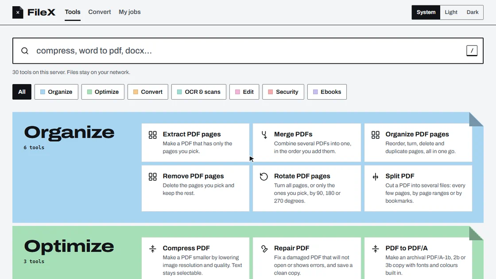
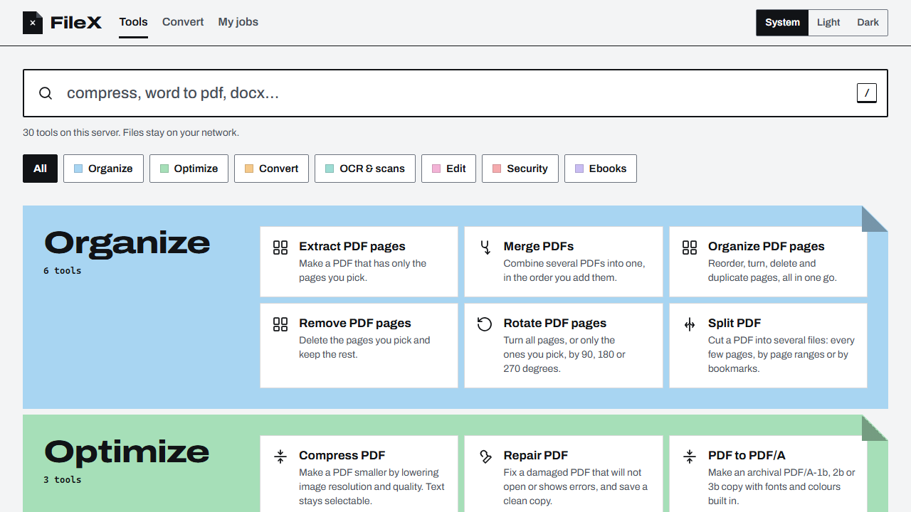
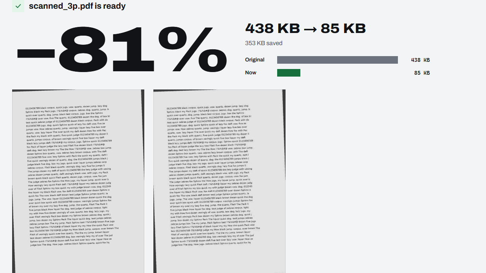
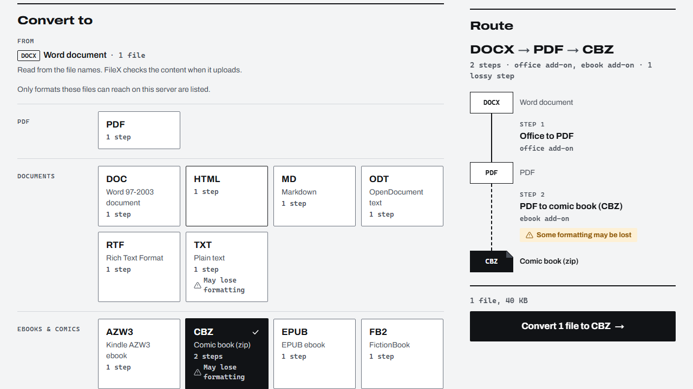
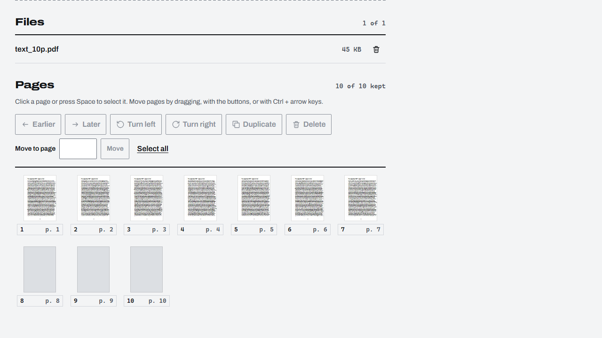

<div align="center">

<picture>
  <source media="(prefers-color-scheme: dark)" srcset="docs/media/banner-dark.svg">
  
</picture>

**Your paper, your computer.** A private toolkit for PDF, Office, ebooks, images and scans:
merge, split, compress, convert, OCR, sign and encrypt, in one web UI with a REST API. It runs in
Docker on your own machine. No account, no cloud.


<br>


[](LICENSE)

[Quick start](#quick-start) · [Tools](#tools) · [Why FileX](#why-filex) · [Home network](#use-it-from-your-phone-or-another-pc-on-your-home-network) · [Hardware](#hardware-and-profiles) · [Privacy](#privacy-and-security) · [API](#rest-api) · [FAQ](#faq) · [Roadmap](#roadmap)

</div>

<p align="center">
  
</p>

FileX uses free and open-source engines only and sends nothing anywhere. Your files stay on your
machine, in FileX's own Docker volume, and are deleted 24 hours after a job finishes, or at once
with "Delete now".

> [!NOTE]
> **Pre-release.** There are no published images yet, so the first start builds them from source.

## Screenshots

The images follow your GitHub theme.

<table>
  <tr>
    <td width="50%">
      <picture>
        <source media="(prefers-color-scheme: dark)" srcset="docs/design/screenshots/catalog-dark.png">
        
      </picture>
      <br><sub><b>Catalog.</b> Search first (<kbd>/</kbd>), then one colour field per family.</sub>
    </td>
    <td width="50%">
      <picture>
        <source media="(prefers-color-scheme: dark)" srcset="docs/design/screenshots/result-compress-dark.png">
        
      </picture>
      <br><sub><b>Compress.</b> Presets or a target size, with a before/after preview.</sub>
    </td>
  </tr>
  <tr>
    <td width="50%">
      <picture>
        <source media="(prefers-color-scheme: dark)" srcset="docs/design/screenshots/convert-dark.png">
        
      </picture>
      <br><sub><b>Convert to any format.</b> The route is shown before anything runs.</sub>
    </td>
    <td width="50%">
      <picture>
        <source media="(prefers-color-scheme: dark)" srcset="docs/design/screenshots/organize-grid-dark.png">
        
      </picture>
      <br><sub><b>Organize pages.</b> Drag to reorder, rotate, delete, duplicate.</sub>
    </td>
  </tr>
</table>

## Quick start

You need Docker: Docker Engine with Compose on x86-64 Linux, or Docker Desktop on Windows or
macOS.

```sh
git clone https://github.com/niklan1110/filex-app.git && cd filex-app
cp .env.example .env
python3 scripts/make_secrets.py      # once: internal queue passwords (or: sh scripts/make_secrets.sh)
docker compose up -d                 # the first start builds the images, which takes a while
```

Open **<http://127.0.0.1:8080>**. There is no account and no sign-in: out of the box FileX runs in
**local mode** (`FILEX_AUTH=none`) and listens on `127.0.0.1` only, so only this computer can
reach it.

Step-by-step install, updates, uninstall and every `.env` setting: [docs/install.md](docs/install.md).

## Tools

30 tools, plus **Convert to any format**, which chains them. Each tool belongs to a worker group: `core`
always runs; `office`, `ocr` and `ebook` are optional compose profiles, so a small machine runs
only what it needs. Options, inputs, warnings and error codes per tool:
[docs/tools.md](docs/tools.md).

| Category | Tools | Group |
|---|---|---|
| **Organize** | Merge PDFs · Split PDF · Organize pages (drag to reorder, rotate, delete) · Extract pages · Remove pages · Rotate pages | `core` |
| **Optimize** | Compress PDF (presets or a target size such as "under 2 MB", with before/after preview) · Repair PDF · PDF to PDF/A | `core` |
| **Convert** | Images to PDF · PDF to images · PDF to text · PDF to Word | `core` |
| **Convert** | Office to PDF · Convert Office files (Word, Excel, PowerPoint, OpenDocument, CSV, text) | `office` |
| **Edit** | Add a watermark · Add page numbers · Edit PDF properties | `core` |
| **Security** | Protect PDF with a password · Remove PDF password · Remove PDF metadata · Sign PDF (PAdES with your own `.p12`) · Create signing certificate | `core` |
| **OCR and scans** | OCR (searchable PDF) · Clean up scans (deskew, clean, blank pages) | `ocr` |
| **Ebooks** | Convert ebooks (EPUB, MOBI, AZW3, FB2, DOCX, PDF, TXT) · Convert Markdown, HTML and documents · DjVu to PDF · Comic book (CBZ/CBR) to PDF · PDF to comic book (CBZ) | `ebook` |
| **Any** | **Convert to any format**: picks a route of up to 4 steps across the tools above, across worker groups if it has to, and shows it before running | all |

## Why FileX

Online PDF sites and desktop suites are good at what they do, but they either take your files or
your money. FileX is for people who would rather keep both.

| | FileX | Online PDF sites | Paid desktop suites |
|---|---|---|---|
| Where your files go | Your own machine, deleted after 24 h | Their servers | Your computer |
| Cost | Free, open-source engines only | Free tier with limits, then a subscription | Licence or subscription |
| Account | None | Theirs | Theirs |
| PDF, Office, ebooks, scans in one place | Yes, plus multi-step conversion routes | Mostly PDF and Office | Mostly PDF |
| Real digital signatures with your own certificate | Yes (PAdES, pyHanko) | Varies | Yes |
| REST API for scripts | Yes, the same API the UI uses | Usually a separate paid plan | Rarely |
| Runs on modest hardware | Yes, 2 GB core-only or 4 GB with everything | n/a | Varies |

Engines, all free and open source: qpdf, pikepdf, PyMuPDF, pypdfium2, Ghostscript and img2pdf
(PDF); LibreOffice and Pandoc (Office); OCRmyPDF, Tesseract, unpaper and OpenCV (OCR and scans);
Calibre and djvulibre (ebooks); pyHanko (signatures).

## Use it from your phone or another PC on your home network

Local mode is only for the computer FileX runs on. To open FileX from other devices, give it an
**access token** and publish it on your computer's home-network address:

1. **Make a token and its hash** (the token goes into your devices, only the hash into `.env`):

   ```sh
   python3 -c "import secrets,hashlib; t='fxt_'+secrets.token_urlsafe(32); print(t); print(hashlib.sha256(t.encode()).hexdigest())"
   ```

2. **Edit `.env`**, with your computer's LAN address (for example `192.168.1.20`):

   ```sh
   FILEX_BIND=192.168.1.20
   FILEX_ALLOWED_HOSTS=localhost,127.0.0.1,192.168.1.20
   FILEX_API_TOKENS=phone:<the 64-character hash>
   # local mode off:
   FILEX_AUTH=
   ```

3. `docker compose up -d`, then open `http://192.168.1.20:8080` on your phone, choose
   **Access token** and paste the `fxt_` token.

FileX refuses to start without sign-in when it listens on anything other than `127.0.0.1`, so a
changed `FILEX_BIND` can never expose an open FileX by accident. Use a separate token per device
(`phone:<hash1>,laptop:<hash2>`) so you can revoke one alone. Keep it on your home network: the
connection is plain HTTP, so don't forward the port to the internet, and never bind to `0.0.0.0`.
Details: [docs/install.md](docs/install.md).

## Hardware and profiles

`COMPOSE_PROFILES` in `.env` picks the worker groups. The default is `office,ocr,ebook`; leave it
empty for core tools only. Heavy steps (LibreOffice, OCR, Calibre) run one at a time by default.

| Machine | Profiles | What to set |
|---|---|---|
| **2 GB RAM** | core only (21 tools, plus Convert between them) | `COMPOSE_PROFILES=` and the low-memory preset at the end of `.env` |
| **4 GB RAM** | `office,ocr,ebook` (everything) | The low-memory preset at the end of `.env` |
| **More than 4 GB** | `office,ocr,ebook` | Nothing: the defaults |

| Worker group | Image (uncompressed) | Adds |
|---|---|---|
| `core`, always on | 473 MB | PDF, images, signing |
| `office` | 908 MB | LibreOffice: Word, Excel, PowerPoint |
| `ocr` | ~1.1 GB | OCRmyPDF, Tesseract, scan cleanup |
| `ebook` | ~2.1 GB | Calibre, Pandoc, DjVu, comic books |

Plan for at least 20 GB free disk for images, build cache and 24 hours of results. A group you
did not enable stays in the catalog with the hint "Enable the `ocr` profile"; add it to
`COMPOSE_PROFILES` and run `docker compose up -d` whenever you like.

## Privacy and security

Every file you drop in is treated as hostile, so a malicious document cannot reach your network
or your other files:

- **No network for engines.** Workers sit on an internal Docker network with no route out. Only
  the web UI and API publish a port, on `127.0.0.1` unless you choose otherwise.
- **One locked-down process per step.** Read-only filesystem, no capabilities, non-root, memory,
  CPU, file-size and time limits, and a seccomp filter per step.
- **Landlock file isolation.** On Linux kernels that have it (5.19+, Docker Desktop included),
  each step can read only its own uploads and write only its own results.
  `FILEX_LANDLOCK=required` makes it mandatory.
- **Checked before parsing.** Types are sniffed from content, sizes capped while streaming,
  archives (DOCX, EPUB, CBZ) checked for entry count, size and path traversal, and documents that
  point at other files on disk resolve to nothing.
- **Short-lived.** Results are deleted 24 hours after a job finishes, or at once with "Delete
  now"; downloads use short-lived signed links.
- **Secrets stay out of sight.** Passwords and certificate passphrases never reach logs, the job
  record or command lines; `.p12` files are deleted right after signing.

Deletion is an ordinary file delete, not shredding (which means little on SSDs and copy-on-write
filesystems anyway); encrypt your disk if you need more.

## REST API

The UI uses the same API you can script against. In local mode, scripts on the same computer need
no token; otherwise send `Authorization: Bearer fxt_...` with a token from
[the step above](#use-it-from-your-phone-or-another-pc-on-your-home-network).

- Contract: [docs/api/openapi.json](docs/api/openapi.json)
- Every tool, its route, options, warnings and errors: [docs/tools.md](docs/tools.md)
- Run a tool: `POST /api/v1/tools/{tool}/jobs` · Convert: `POST /api/v1/convert/jobs`, with a
  preview at `GET /api/v1/convert/plan?from=docx&to=pdf`

<details>
<summary><b>Example: merge two PDFs with curl</b></summary>

```sh
API=http://127.0.0.1:8080/api/v1
curl -s -F files=@a.pdf -F files=@b.pdf "$API/tools/pdf.merge/jobs"
# {"id":"j_...","status":"QUEUED",...}
JOB=<the j_ id>
curl -s "$API/jobs/$JOB"                          # repeat until "status":"SUCCEEDED"
curl -fsS -o merged.pdf "$API/jobs/$JOB/result"
```

With a token, add `-H "Authorization: Bearer $TOKEN"` to each call.

</details>

## FAQ

<details>
<summary><b><code>docker compose up</code> says a secret file is missing</b></summary>

Run `python3 scripts/make_secrets.py` (or `sh scripts/make_secrets.sh`) once, then start again.
</details>

<details>
<summary><b>FileX will not start after I changed <code>FILEX_BIND</code></b></summary>

That is the guard: without sign-in, FileX only listens on `127.0.0.1`. Set `FILEX_API_TOKENS` and
turn local mode off (`FILEX_AUTH=`), as in
[the home-network section](#use-it-from-your-phone-or-another-pc-on-your-home-network).
</details>

<details>
<summary><b>The browser says <code>Invalid host header</code></b></summary>

The address in the address bar is not in `FILEX_ALLOWED_HOSTS`. Add it (no `http://`, no port),
then `docker compose up -d`.
</details>

<details>
<summary><b>A tool says "Enable the <code>ocr</code> profile" (or <code>office</code>, <code>ebook</code>)</b></summary>

That worker group is not running. Add it to `COMPOSE_PROFILES`, then `docker compose up -d`. If it
is listed, check `docker compose ps` and `docker compose logs worker-ocr`.
</details>

<details>
<summary><b>Port 8080 is already in use</b></summary>

Set `FILEX_PORT` in `.env` to a free port, then `docker compose up -d`.
</details>

<details>
<summary><b>Uploads fail with <code>413</code> or <code>507</code></b></summary>

`413`: the upload is bigger than `FILEX_MAX_UPLOAD_MB`. `507`: it would leave less free disk than
`FILEX_MIN_FREE_MB`. Free space ("Delete now" on old jobs, `docker image prune -f`) or adjust the
limits, keeping `FILEX_MIN_FREE_MB` at least twice `FILEX_MAX_UPLOAD_MB`.
</details>

<details>
<summary><b>A job fails with <code>ENGINE_MEMORY</code></b></summary>

The worker hit its memory cap. Raise that group's `FILEX_MEM_*` if the machine has room;
otherwise split the document.
</details>

<details>
<summary><b>A long ebook will not convert to PDF</b></summary>

Calibre's PDF output needs memory per page, so books over roughly 230 estimated pages are refused
up front with `TOO_MANY_PAGES` instead of hanging. Convert them to EPUB, MOBI or AZW3.
</details>

<details>
<summary><b>Is anything sent over the internet?</b></summary>

No. The internet is needed only while the images build (Debian, Python and Node packages). Once
running, FileX talks to nothing outside your machine, and the workers have no route out at all.
Logs never contain file names, passwords or tokens.
</details>

<details>
<summary><b>Does it run on ARM (Raspberry Pi, Apple silicon)?</b></summary>

Not yet. The images are x86-64; ARM64 images are planned. On Windows and macOS with an Intel or
AMD CPU, Docker Desktop works.
</details>

More: [docs/install.md](docs/install.md).

## Roadmap

**Release 1** (in progress): the 30 tools above and Convert to any format.

<details>
<summary><b>Release 2: going further</b></summary>

- More ebook formats (KEPUB, LIT, PDB, CB7, comic to EPUB)
- Accurate PDF to Word and PDF to Markdown, full scan cleanup (dewarp, whitening, MRC)
- Trust tools: verifiable redaction, sanitize, signature validation, signing timestamps
- Compare PDFs (text and visual)
- Image tools, HTML to PDF, PDF to Excel / PowerPoint / HTML / Markdown, crop, n-up, booklet,
  flatten, grayscale, PDF/A validation and more
- Job history and saved presets

</details>

<details>
<summary><b>Release 3: automation and platform</b></summary>

- Recipes: chain tools with per-step options, from the UI and the API
- Watch folders and webhooks
- ARM64 images
- Personal-data redaction, Office compare, forms filling, e-invoices, email to PDF, bookmarks,
  attachments and more

</details>

## Development

```sh
pytest -q                                   # backend tests (engine tests skip without the engines)
ruff check . && ruff format --check .       # lint
python scripts/gen_openapi.py --check       # contract up to date
python scripts/gen_tool_docs.py             # regenerate docs/tools.md
npm --prefix web run dev                    # UI dev server
npm --prefix web test                       # UI tests
```

Python 3.12, FastAPI, Valkey (Redis-compatible) streams for the job queue, React + Vite for the UI. One multi-stage
[docker/Dockerfile](docker/Dockerfile) builds the API and each worker image.

## License

AGPL-3.0, see [LICENSE](LICENSE). The bundled engines keep their own licenses (among them AGPL
Ghostscript and PyMuPDF, and GPL Calibre, Pandoc, djvulibre and Poppler); see
[THIRD_PARTY_NOTICES.md](THIRD_PARTY_NOTICES.md).

<p align="center"><sub><a href="https://github.com/niklan1110/filex-app">FileX</a> by <a href="https://github.com/niklan1110">niklan1110</a>. Your paper, your computer.</sub></p>
